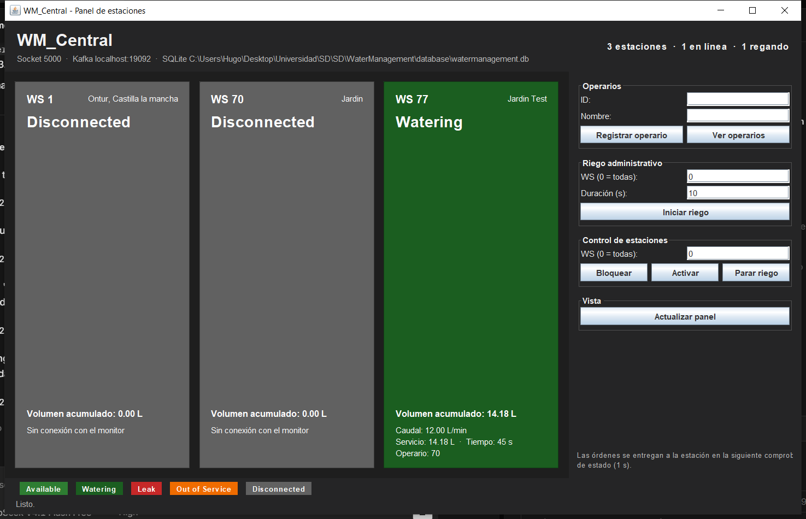
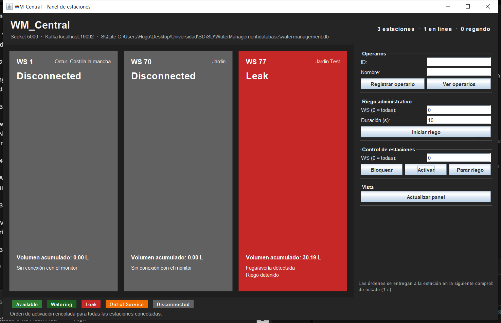
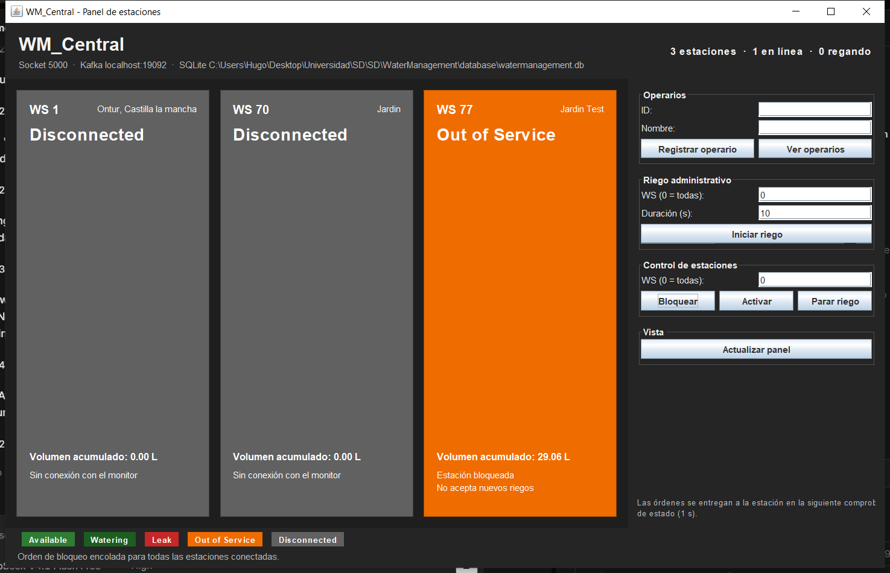
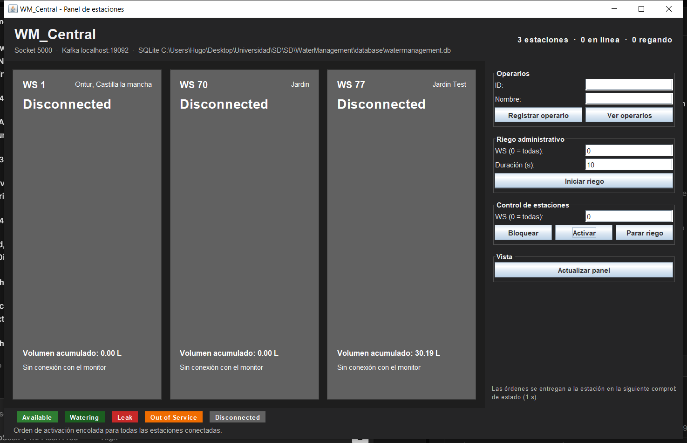
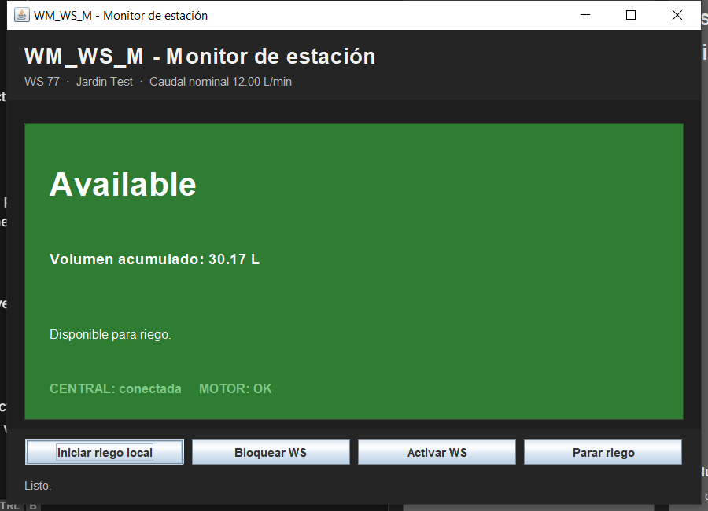
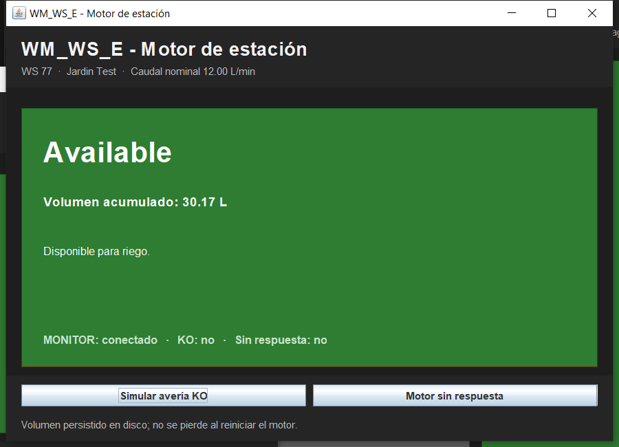
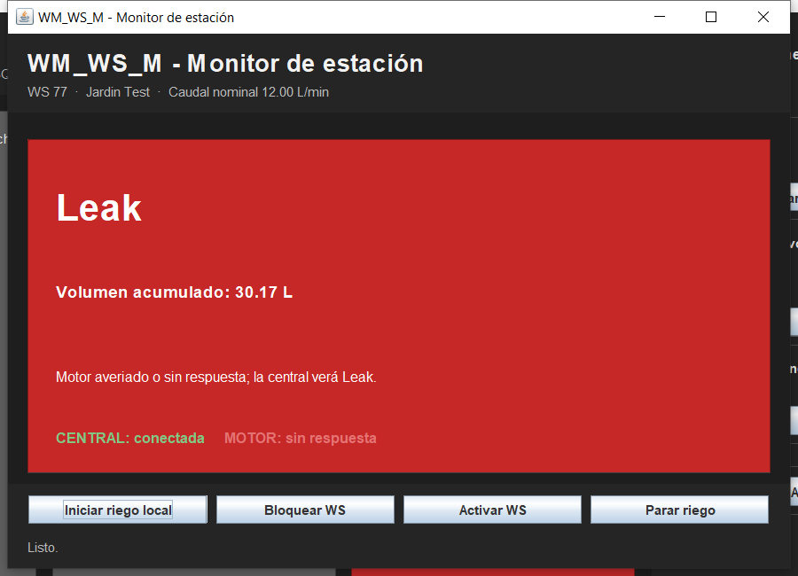
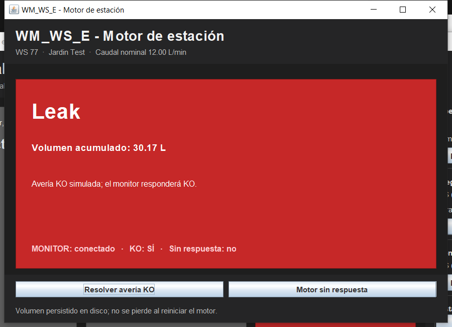
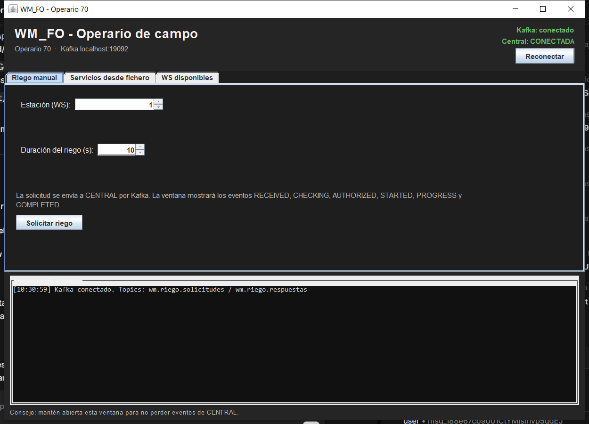
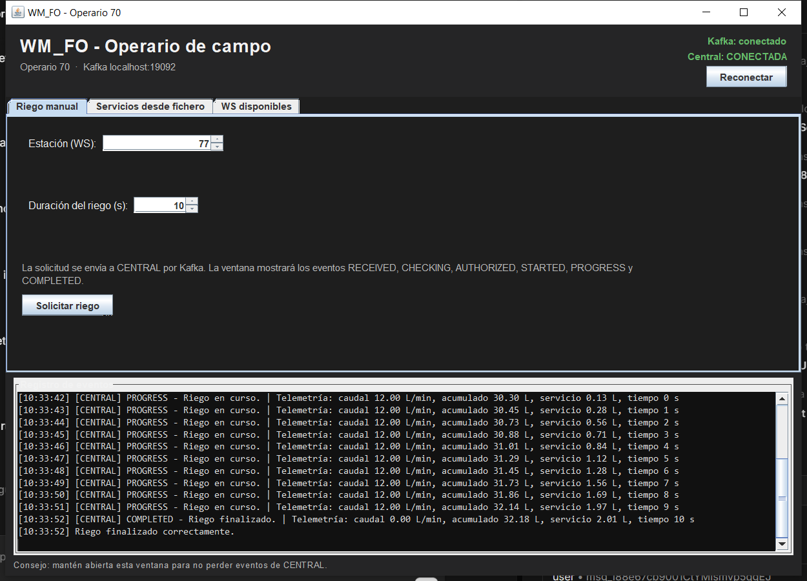

# WaterManagement — Memoria de la práctica

**Asignatura:** Sistemas Distribuidos (SD 26/27) · Release 1
**Autores:** Hugo Nicolás Vila Bernabeu · Kevin Monasterios Espejo
**Repositorio:** GitHub (UA_SD) — `WaterManagement/`

---

## 1. Introducción

WaterManagement es un sistema distribuido de **gestión inteligente de riego** formado por
procesos independientes que se comunican por **sockets** (tramas `STX/DATA/ETX/LRC`) y por
**Kafka** (topics de solicitudes, respuestas y latidos). Está pensado para desplegarse en dos
entornos:

- **Cloud (AWS / Railway):** `WM_Central`, el broker Kafka y la base de datos SQLite.
- **Laboratorio:** las estaciones `WM_WS` (monitor + motor) y los operarios `WM_FO`.

Cada módulo se ejecuta **sin IDE** y admite múltiples instancias simultáneas, tolerando
caídas abruptas de cualquier componente sin perder transacciones ni volumen de agua regado.

---

## 2. Arquitectura

```
                        +----------------------------+
                        |        CLOUD (AWS)         |
                        |   Kafka  <----> WM_Central |
                        |              |             |
                        |              SQLite        |
                        +--------------+-------------+
                                       | socket STX/ETX/LRC (5000)
                 +---------------------+----------------------+
                 |                                            |
          +------v-------+                              +------v-------+
          |  WM_WS (lab) |        Kafka (9092)          |  WM_FO (lab) |
          |  monitor+    |<---------------------------->|  operario    |
          |  motor       |                              +--------------+
          +--------------+
```

### Estados de una estación (colores exigidos)

| Estado | Color | Detalle |
|---|---|---|
| Available | verde | disponible para riego |
| Watering | verde parpadeante | caudal L/min, volumen acumulado, operario |
| Leak | rojo | motor KO / sin respuesta |
| Out of Service | naranja | leyenda literal “Out of Service” |
| Disconnected | gris | no se reciben latidos del monitor |

---

## 3. Componentes software desarrollados

### 3.1 WM_Central (servicio central)

Coordina las estaciones y los riegos. Persiste en SQLite las WS, los operarios y las
solicitudes, y publica/consume en Kafka.

| Fichero | Descripción |
|---|---|
| `WM_Central/src/ServidorCentral.java` | Punto de entrada. Lee parámetros, inicia la central y abre la GUI o la consola. |
| `WM_Central/src/CentralService.java` | Lógica de negocio: autenticación de WS, validación de riegos, máquina de estados, Kafka, panel y recuperación. |
| `WM_Central/src/HiloCentral.java` | Un hilo por cada conexión persistente de monitor. Gestiona `ENQ/HELLO/STATUS/CMD`. |
| `WM_Central/src/BaseDatos.java` | Capa SQLite (tablas `WS`, `Operario`, `SolicitudRiego`), volumen monotónico y eventos terminales. |
| `WM_Central/src/WireProtocol.java` | Tramas `STX/DATA/ETX/LRC` y bytes de control. |
| `WM_Central/src/CentralFrame.java` | Panel gráfico Swing: tarjetas de estación y administración. |
| `WM_Central/src/UiSupport.java` | Decide GUI o consola (según `WM_GUI` y el escritorio). |

**Parámetros** (argumentos o variables): `WM_CENTRAL_PORT` (5000), `WM_KAFKA_HOST`
(localhost), `WM_KAFKA_PORT` (9092), `WM_DB_PATH` (database/watermanagement.db),
`WM_WS_ALLOWED_IDS`, `WM_WS_REQUIRE_KNOWN`, `WM_GUI`.

### 3.2 WM_WS_M (monitor de la estación)

Se autentica contra `WM_Central`, envía el estado cada segundo y comprueba la salud del
motor cada ~700 ms. Reenvía al motor las órdenes de la central y del menú local.

| Fichero | Descripción |
|---|---|
| `WM_WS/src/WM_WS_M.java` | Monitor: autenticación, envío de `STATUS`, recepción de `CMD`, menú local y enlace con el motor. |
| `WM_WS/src/WSMonitorFrame.java` | Ventana gráfica del monitor (estado, enlaces y controles locales). |
| `WM_WS/src/WireProtocol.java` | Tramas `STX/DATA/ETX/LRC`. |
| `WM_WS/src/UiSupport.java` | Decide GUI o consola. |

**Parámetros:** `<puertoMotor> <ipCentral> <puertoCentral> <idWS> <ubicacion> <caudalLMin>`
y `WM_MONITOR_PORT`, `WM_CENTRAL_HOST`, `WM_CENTRAL_PORT`, `WM_WS_ID`, `WM_WS_LOCATION`,
`WM_WS_FLOW`, `WM_STATUS_INTERVAL_MS`.

### 3.3 WM_WS_E (motor de la estación)

Ejecuta el riego simulado, acumula el agua suministrada y **la persiste en disco**
(`ws_<id>.state`) para no perderla jamás. Permite simular una avería KO o un motor sin
respuesta.

| Fichero | Descripción |
|---|---|
| `WM_WS/src/WM_WS_E.java` | Motor: identificación, `POLL/STATUS`, ejecución de órdenes, persistencia y recuperación. |
| `WM_WS/src/WSEngineFrame.java` | Ventana gráfica del motor (estado, volumen, informe pendiente, simulación de avería). |

**Parámetros:** `<ipMonitor> <puertoMonitor> [dirEstado]` y `WM_MONITOR_HOST`,
`WM_MONITOR_PORT`, `WM_WS_STATE_DIR`.

### 3.4 WM_FO (operario de campo)

Solicita riegos por Kafka, procesa ficheros de servicios de forma secuencial, consulta las
WS disponibles y recupera el resultado de servicios pendientes.

| Fichero | Descripción |
|---|---|
| `WM_FO/src/WM_FO.java` | Consola del operario (riego manual, fichero, WS disponibles). |
| `WM_FO/src/ClienteKafkaOperario.java` | Cliente Kafka: publica solicitudes, correlaciona respuestas, detecta el latido de la central y persiste los servicios pendientes. |
| `WM_FO/src/FOFrame.java` | Ventana gráfica del operario (manual, fichero, WS disponibles, registro de eventos). |
| `WM_FO/src/UiSupport.java` | Decide GUI o consola. |

**Parámetros:** `[ipBroker] [puertoBroker] [idOperario]` y `WM_KAFKA_HOST`, `WM_KAFKA_PORT`,
`WM_FO_ID`, `WM_FO_MANAGE_TOPICS`, `WM_FO_TIMEOUT_SECONDS`, `WM_FO_STATE_DIR`.

> **Código fuente completo:** todos estos ficheros se adjuntan en
> [`Anexo_CodigoFuente.md`](Anexo_CodigoFuente.md), en el mismo orden que esta sección.

---

## 4. Comunicación y protocolos

- **Socket CENTRAL ↔ monitor:** control `ENQ → ACK/NACK → respuesta`; datos en trama
  `STX/DATA/ETX/LRC` (LRC = XOR de los bytes de DATA). El `HELLO` autentica la WS y las
  órdenes se anexan a la respuesta del `STATUS` como `#CMD#TIPO|requestId|operario|duracion`.
- **Monitor ↔ motor:** `ID` (identificación) y `POLL/STATUS` (petición-respuesta sin ACK
  duplicado). El motor responde `KO` cuando está averiado.
- **Kafka FO ↔ CENTRAL:** `wm.riego.solicitudes` (`RIEGO_REQUEST`, `LIST_AVAILABLE_WS`,
  `CONSULTAR_ESTADO`), `wm.riego.respuestas` (`RIEGO_EVENT`, `AVAILABLE_WS_LIST`) y
  `wm.central.latido` (latido). Los operarios solo reciben los eventos de su `operatorId`,
  pero pueden listar todas las WS disponibles.

---

## 5. Requisitos cubiertos

- **Base:** registro/autenticación de WS (aceptación/denegación), validación de
  disponibilidad, riego desde FO / menú WS / Central, bloqueo–activación, estados con
  colores, control desde una o todas las WS, latido y aviso “Imposible conectar con
  WM_Central”.
- **Resiliencia:** caída de monitor (→ Disconnected), de motor (→ Leak, aborta riego y
  conserva el volumen), de FO (el riego sigue y se recupera el resultado), de CENTRAL (las
  WS terminan y no se admiten nuevas peticiones), y recuperación reiniciando el mínimo de
  módulos.
- **General:** protocolo de tramas `<STX>D<ETX><LRC>`, sin pérdida de transacciones,
  interfaces gráficas (Swing) con respaldo de consola, despliegue sin IDE.

---

## 6. Guía de despliegue (la misma de la corrección)

### 6.1 Requisitos previos

- JDK 17+ (compilación) y JRE para ejecutar.
- Broker Kafka accesible (KRaft de un nodo es suficiente).
- Para las ventanas: escritorio local (o X11/VNC contra el servidor).

### 6.2 Compilar sin IDE

```bash
cd WaterManagement
# Linux/macOS
./scripts/build.sh
# Windows (PowerShell)
powershell -ExecutionPolicy Bypass -File scripts\build.ps1
```

La compilación deja las clases en `WM_Central/out`, `WM_FO/out` y `WM_WS/bin`, usando las
librerías de `WaterManagement/lib`.

### 6.3 Desplegar Kafka (KRaft, un nodo)

```bash
docker run -d --name kafka -p 9092:9092 \
  -e KAFKA_NODE_ID=1 \
  -e KAFKA_PROCESS_ROLES=broker,controller \
  -e KAFKA_LISTENERS=PLAINTEXT://0.0.0.0:9092,CONTROLLER://0.0.0.0:9093 \
  -e KAFKA_ADVERTISED_LISTENERS=PLAINTEXT://<IP_PUBLICA>:9092 \
  -e KAFKA_CONTROLLER_LISTENER_NAMES=CONTROLLER \
  -e KAFKA_LISTENER_SECURITY_PROTOCOL_MAP=CONTROLLER:PLAINTEXT,PLAINTEXT:PLAINTEXT \
  -e KAFKA_CONTROLLER_QUORUM_VOTERS=1@localhost:9093 \
  -e KAFKA_OFFSETS_TOPIC_REPLICATION_FACTOR=1 \
  apache/kafka:3.9.1
```

> `ADVERTISED_LISTENERS` debe llevar la IP pública para que el laboratorio conecte.

### 6.4 Desplegar WM_Central en la nube (headless)

```bash
# En el servidor (AWS/Railway), con la base SQLite local a la central:
export WM_GUI=false
java -cp "WM_Central/out:lib/*" ServidorCentral 5000 localhost 9092 /data/watermanagement.db
```

- `5000` = socket de monitores (abierto en el Security Group).
- `localhost 9092` = Kafka del propio servidor.

### 6.5 Desplegar WM_WS en el laboratorio

```bash
# Motor (se conecta al monitor por el puerto 6000)
java -cp "WM_WS/bin" WM_WS_E localhost 6000 ./state

# Monitor (se conecta a la CENTRAL de la nube)
java -cp "WM_WS/bin" WM_WS_M 6000 <IP_PUBLICA> 5000 77 "Jardin Test" 12.0
```

### 6.6 Desplegar WM_FO en el laboratorio

```bash
java -cp "WM_FO/out:lib/*" WM_FO <IP_PUBLICA> 9092 70
```

### 6.7 Ver la interfaz gráfica desde tu ordenador

Las ventanas se dibujan donde corre el proceso. Para las de **WM_WS y WM_FO**, al lanzarlas
en el laboratorio se abren localmente (no hace falta nada más). Para ver la ventana de
**WM_Central** desplegada en AWS, usa una de estas opciones:

1. **X11 forwarding (rápida):** en tu PC inicia un servidor X (VcXsrv/X410/MobaXterm en
   Windows, XQuartz en macOS). En el servidor: `sudo apt install -y xauth libxext6
   libxrender1 libxtst6 libxi6 fontconfig openjdk-17-jdk`, activa `X11Forwarding yes` en
   `/etc/ssh/sshd_config`, y conéctate con `ssh -X -C usuario@<IP_PUBLICA>`. Lanza la
   central **sin** `WM_GUI=false` y la ventana aparecerá en tu PC.
2. **VNC:** `sudo apt install -y xfce4 tigervnc-standalone-server && vncserver :1
   -geometry 1440x900`; crea el túnel `ssh -L 5901:localhost:5901 usuario@<IP_PUBLICA>` y
   conecta un visor VNC a `localhost:5901`.
3. **RDP:** `sudo apt install -y xrdp xfce4 && sudo systemctl enable --now xrdp`; conecta
   “Escritorio remoto” a la IP pública (restringe el SG a tu IP).

> `WM_GUI=false` fuerza consola; **no** lo definas si quieres la ventana.

### 6.8 Orden de arranque completo

1. Kafka.
2. `WM_Central` (nube).
3. `WM_WS_E` (motor) y `WM_WS_M` (monitor) por cada estación.
4. `WM_FO` (operario) por cada operario.

---

## 7. Capturas de pantalla

### 7.1 WM_Central — estación regando (Watering, verde)


Se observan las tarjetas de estación con sus estados y colores: WS 77 en **Watering**
(verde) con caudal, volumen acumulado y operario, y las WS 1 y 70 en **Disconnected** (gris).

### 7.2 WM_Central — Leak (rojo)


Al simular una avería KO en el motor, la central muestra la WS 77 en **Leak** (rojo) y
aborta el riego conservando el volumen ya suministrado.

### 7.3 WM_Central — Out of Service (naranja)


Tras la orden de bloqueo, la estación pasa a **Out of Service** (naranja) con la leyenda
literal.

### 7.4 WM_Central — Disconnected (gris)


Al detener el monitor, la central marca la WS como **Disconnected** (gris).

### 7.5 Monitor de la WS — disponible


Ventana del monitor con el estado de la estación y los indicadores de enlace con CENTRAL y
con el motor.

### 7.6 Motor de la WS — disponible


Ventana del motor con el volumen acumulado y los botones de simulación de avería.

### 7.7 Monitor — Leak


El monitor detecta la avería del motor y muestra la estación en **Leak** (rojo).

### 7.8 Motor — Leak (KO)


El motor con la avería KO activa y el informe final pendiente de confirmar.

### 7.9 Operario (WM_FO) — conectado


Ventana del operario con Kafka conectado, latido de CENTRAL y pestañas de riego manual,
fichero y WS disponibles.

### 7.10 Operario (WM_FO) — riego en curso y completado


El operario solicita un riego a la WS 77 y recibe los eventos `AUTHORIZED`, `STARTED`,
`PROGRESS` y `COMPLETED` con la telemetría del servicio.

---

## 8. Pruebas realizadas

1. Integración completa `WM_FO → Kafka → WM_Central → WM_WS → WM_WS_E` (riego 10 s con
   `AVAILABLE → Watering → COMPLETED` y volumen de servicio). **OK.**
2. Latido: al caer `WM_Central`, el FO avisa “Imposible conectar con WM_Central”. **OK.**
3. Resiliencia: monitor caído → Disconnected; motor KO → Leak y aborto del riego;
   recuperación → Available con volumen conservado; bloqueo → Out of Service. **OK.**
4. Caída del motor durante un riego → fuga → reinicio conserva el volumen acumulado. **OK.**
5. Caída del FO durante un riego → el riego continúa y, al reiniciar, recupera y muestra el
   resultado final (`CONSULTAR_ESTADO` + fichero de pendientes). **OK.**
